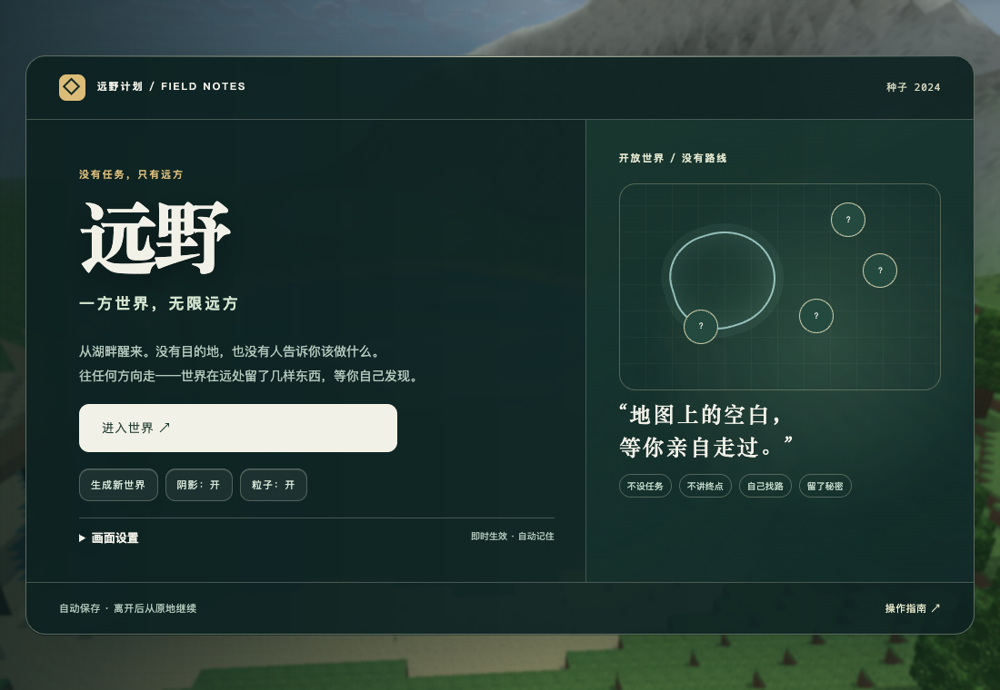
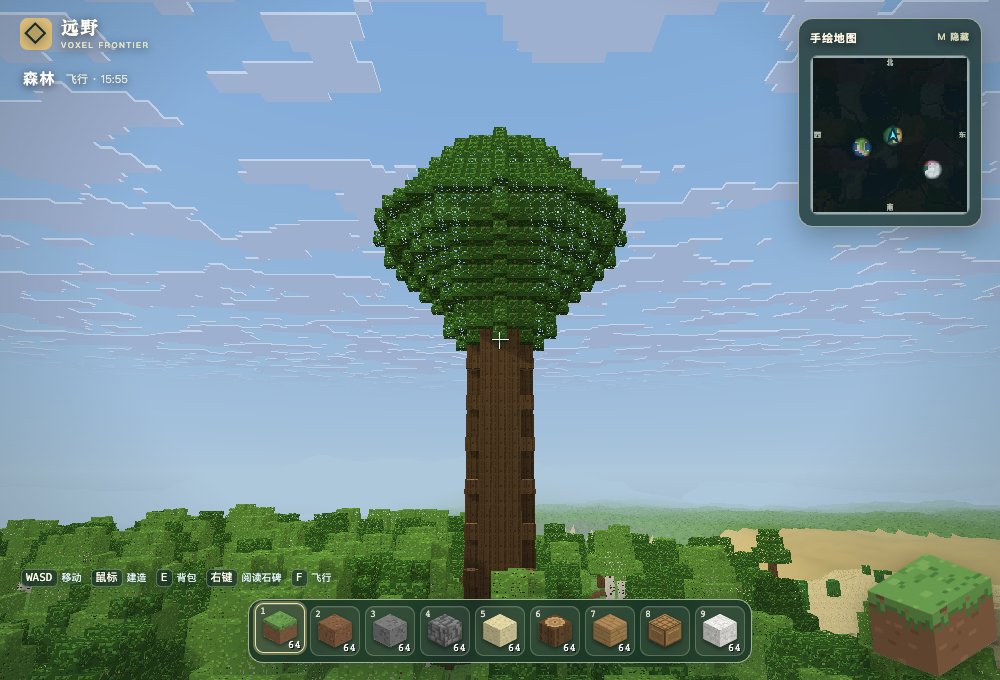
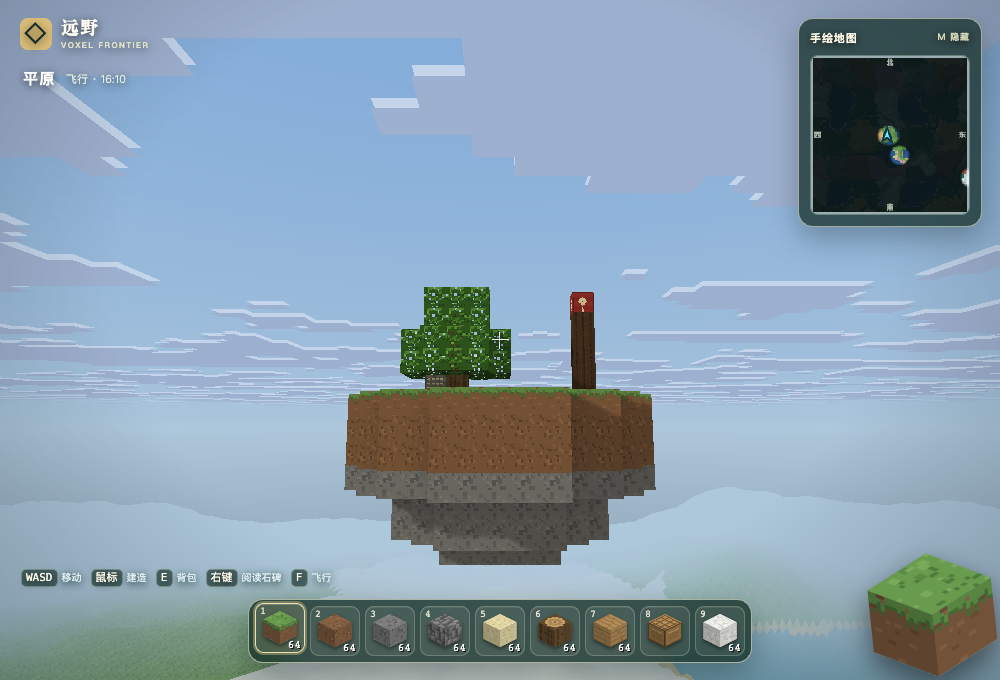
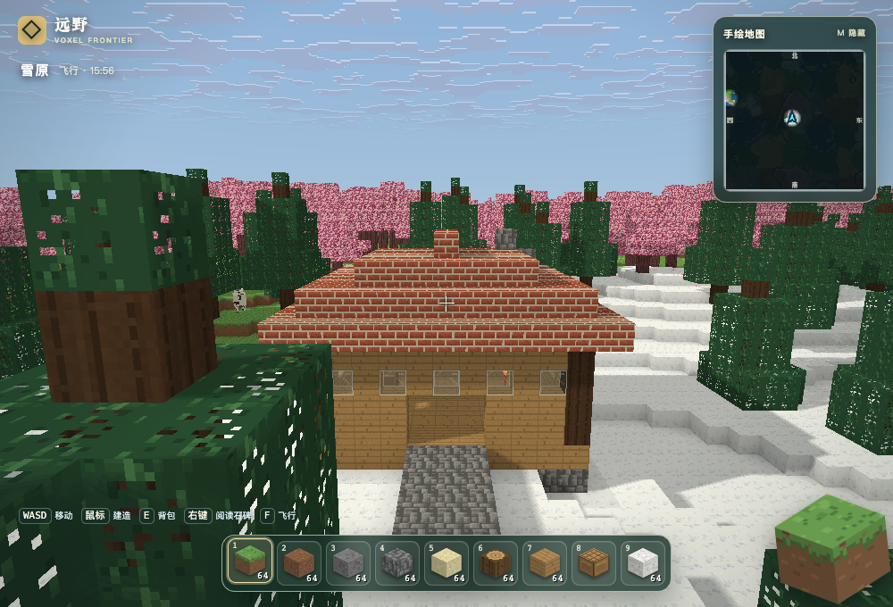
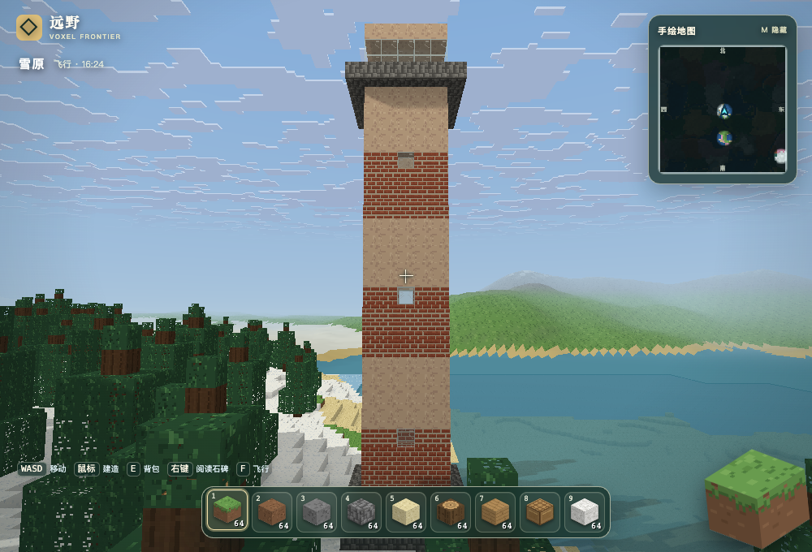
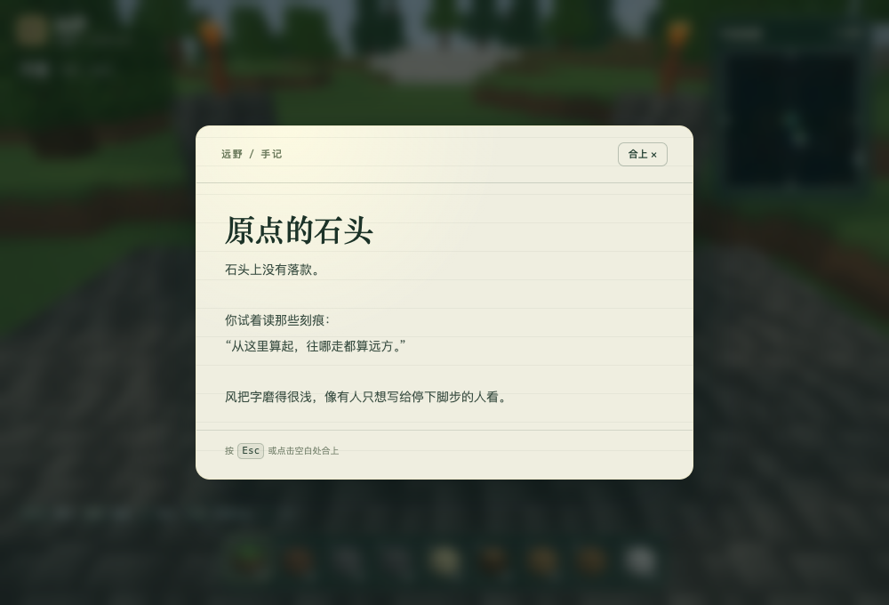
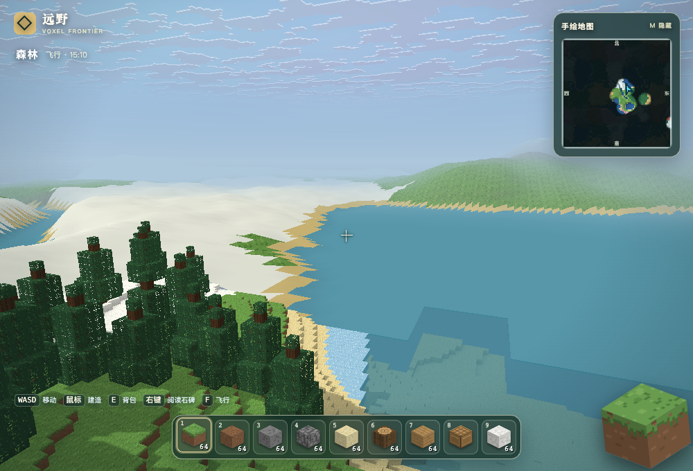
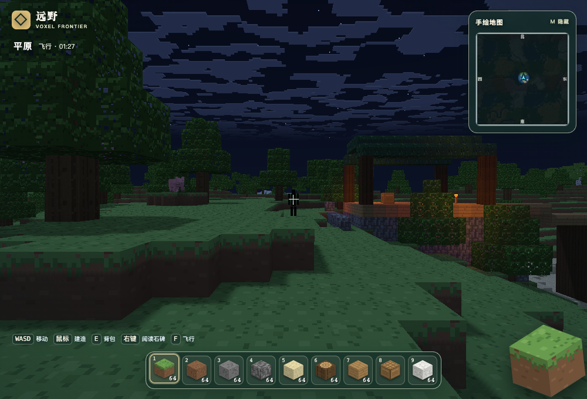
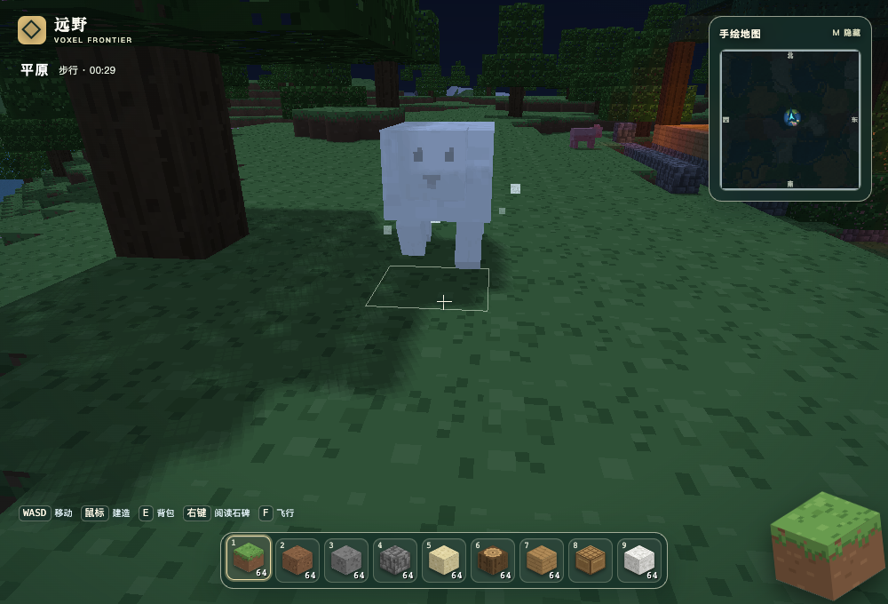
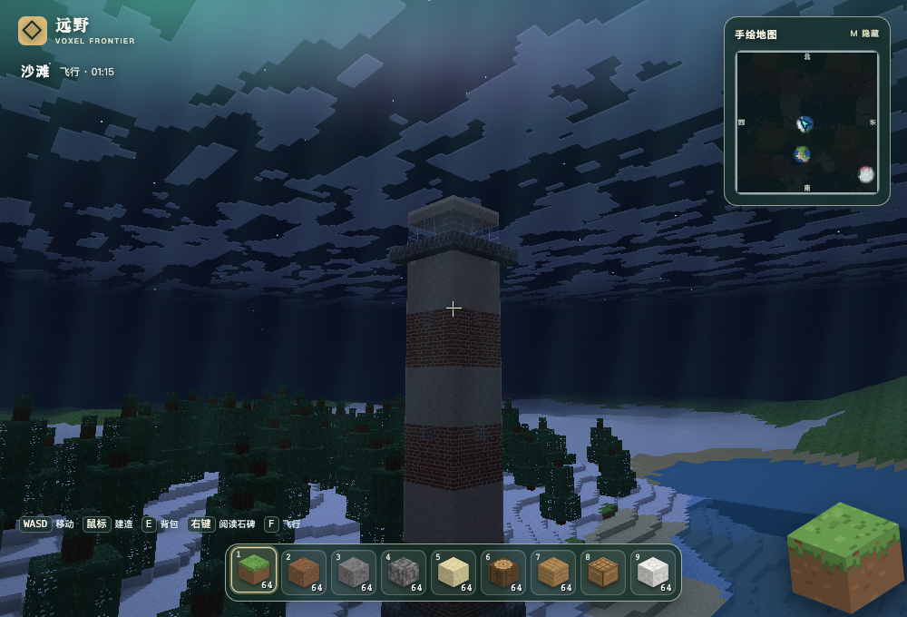

# 远野 · 开放世界

**没有任务，只有远方。**

一个**纯手写、零依赖**的浏览器体素沙盒：没有 Three.js，没有贴图文件，没有构建步骤。
整个世界、**16×16 像素材质**、天空、音效都由代码实时生成，直接双击 `index.html` 就能玩。

这一版把上一版的「探索手册 / 航标追踪 / 登顶发钻石」整套任务结构拆掉了：
没有任务栏、没有完成度、没有目标箭头。世界用看得见的巨物、听得见的声音和
**14 个不会出现在任何列表里的彩蛋**，让玩家自己决定往哪走。

  







---

## 立即开始

```bash
# 方式一：直接双击
open index.html

# 方式二：本地静态服务器（可选）
python3 -m http.server 8000
# 浏览器打开 http://localhost:8000
```

> 需要支持 **WebGL2** 的现代浏览器（Chrome / Edge / Safari 15+ / Firefox）。
> 进度条走完点「进入世界」，鼠标会被锁定，按 `ESC` 暂停。

## 操作

| 按键 | 功能 |
| --- | --- |
| `W` `A` `S` `D` | 移动 |
| `空格` | 跳跃 / 游泳 / 飞行上升 |
| `Shift` | 疾跑（飞行时下降） |
| `Ctrl` | 飞行时加速 |
| 鼠标移动 | 环顾四周 |
| 左键（可长按） | 挖掘方块 / 攻击生物 |
| 右键 | 放置方块；对着石碑、纸条、石中剑时改为阅读 / 互动 |
| `1` – `9` / 滚轮 | 切换快捷栏 |
| `E` | 背包（背包 / 创造模式两个页签） |
| 右键合成台 | 打开 3×3 合成界面 |
| `F` / 双击空格 | 切换飞行 |
| `M` | 展开 / 收起右上角手绘地图 |
| `T` | 切换正午 / 日落 / 午夜 / 日出 |
| `F3` | 显示 / 隐藏坐标、帧率与面数 |
| `ESC` | 暂停 / 释放鼠标；阅读时合上手记 |
| `J` | 已移除；世界不再发放手册 |

## 这一版做了什么

### 一个没有任务线的世界

- 删除探索手册、`0 / 5` 完成度、追踪目标、罗盘指向与距离、登顶钻石奖励。
- 删除出生点的「先去营地、再去石门」导览卡片；营地、栈道、石门仍然是场景。
- 右上角地图改成**探索迷雾**：只画走过的地方，没走过的区域是留白；不标地标、不画路线、不给距离。
- 进入世界后不需要打开任何面板就能玩；所有地点、彩蛋、建筑都不设门槛。
- 旧存档兼容：旧的 `discovered` / `tracked` / `summitEggs` 字段读入后忽略，不报错、不丢档。

### 看得见的远方

每个种子都会在不同位置放置几类**轮廓独特、远处可辨**的巨物：

- **巨树**：40 格高的树冠，在森林里像一个地标。
- **灯塔**：海岸边 24 格高的红白塔，塔顶有玻璃灯笼房。
- **巨拱**：跨度 12 格、高 29 格的石拱门。
- **石像**：山地肩部的 21 格高守望者。
- **沉船**：湖底 / 海底的船体与桅杆，船舱里有一页船长日志。
- **霜线前哨、回声石门、两座雪山、湖畔营地**：原有场景保留，但不再作为任务目标。

### 世界的痕迹

- **开发者小屋**：离出生点约 700 格，林间空地、坡屋顶、像素肖像、桌前的手记。
- **九座石碑**：平原、森林、沙漠、樱花林、山地、恶地、雪原、针叶林、沙滩各一座，
  拼起来是一段关于「远野」的往事。谁先找到哪一块都行。
- **废弃小屋**：林子边缘的混凝土房间，里面有一块粉黑相间的「丢失的贴图」。
- **长椅、石堆、沉船日志**：只写世界与人物，不发布任务、不给坐标、不承诺奖励。
- **洞穴里的滴水与脚步声**：只在很深的地方出现，没有实体。

### 头顶与夜里的东西

- **凌晨三点的远影**：0:00–3:30 之间偶尔出现在视距边缘，注视太久或靠近会消散。
- **月圆白羊**：每第 8 天（含第一个夜晚）的满月夜，附近会出现一只发微光的白羊。
- **极光**：雪原、山地或冻洋的夜里，约 3% 的概率。
- **流星雨**：任意夜晚约 1.2% 的概率。
- **KONAMI 码**：在标题页或暂停页输入 `↑ ↑ ↓ ↓ ← → ← → B A`。
- 具体位置、概率和触发方式都在 **[SPOILERS.md](SPOILERS.md)**。README 不剧透。

### 沙盒本身

- **一个连续世界**：9 种地表群系、洞穴群系、河流、海岸、雪山与远景 LOD，任意方向连续生成。
- **86 件物品 / 44 种方块 / 36 条配方 / 25 把工具**，全部程序化 16×16 图标与材质。
- **火把体素光**、20 分钟昼夜、阴影、粒子、工具耐久、合成扣材料、水下蓝雾与闷音。
- **5 种动物**：羊、鸡、牛、猪、兔子；会溜达、受击、掉落。
- **手绘地图**：探索记录会写进存档，隐藏地标不会提前出现。
- **程序化声音**：按材质区分的挖掘/放置/脚步，羊叫、鸡叫、水花、鸟鸣、虫鸣、洞穴回声、海浪、风。
- **零依赖、零构建、`file://` 可玩**；画面设置与存档分开保存。

## 截图















## 技术细节

```
minecraft/
├── index.html          页面外壳、HUD、阅读面板、启动/暂停、背包与合成 UI
├── css/redesign.css    界面、阅读手记、极光与流星样式
├── screenshots/        截图
└── js/
    ├── noise.js        mulberry32 随机数 + 2D/3D 值噪声 + fBm
    ├── blocks.js       16×16 程序化图集；方块表、硬度、石碑/石中剑/丢失贴图/旗帜
    ├── world.js        区块、地形、洞穴、群系、雪山、步道、开放世界站点与注脚
    ├── minimap.js      手绘地图、探索迷雾、玩家朝向
    ├── horizon.js      远景简化山体
    ├── mesher.js       面剔除 + AO 顶点烘焙 + 天空深度
    ├── renderer.js     原生 WebGL2：着色器、天空、日月、阴影、透明批次
    ├── particles.js    512 粒子池；支持低重力粒子（月光、远影）
    ├── viewmodel.js    空手第一人称手臂
    ├── player.js       AABB 碰撞、水中/飞行、DDA 体素射线
    ├── items.js        物品注册表、材料与 25 把工具的程序化图标
    ├── crafting.js     36 条配方 + 3×3 形状匹配
    ├── mobs.js         5 种动物的盒子模型、走跳动画、生成与回收
    ├── secrets.js      14 个彩蛋的触发、存档、远影渲染与调试入口
    ├── settings.js     画面偏好验证与独立持久化
    └── main.js         启动、输入、区块调度、挖掘放置、阅读、存档、音效、HUD
```

几个关键设计：

- **彩蛋不进入 UI**：`secrets.js` 只做注册、每秒一次的时间/坐标检查和一次性存档，
  不逐帧扫描世界；结构性彩蛋在区块生成阶段按种子选址。
- **手绘地图**：地图底图仍按 96×96 分帧生成，但被一层「墨」盖住；只有玩家走过的点会
  以柔和笔触擦开迷雾，探索点上限 640，随存档保存。
- **注脚与站点**：`world.js` 在构造时按种子选出原点、小屋、实验室、沉船、长椅、
  九座石碑和四类远景地标的位置；区块生成时只处理与自己相交的站点。
- **阅读**：石碑/纸条/日志共用一张纸面板，右键打开，`Esc` 合上；阅读会写入
  `save.secrets`，但不产生任务、进度或奖励。
- **存档**：`localStorage['mcweb.save.v1']` 保存方块改动、背包、位置、时间、彩蛋记录与
  探索点；画面偏好单独存在 `mcweb.settings.v1`。
- **不打包 Mojang 素材**：所有贴图与音效都是代码生成的，见下文。

## 调参

- 换个世界：启动页「生成新世界」，或在地址栏加 `?seed=12345`（也支持文字种子）。
- 想飞：进游戏按 `F`。
- 调试模式：`?auto=1` 跳过菜单直接进入；`?debug=1` 会暴露 `window.__mc.debug`。
- 调试彩蛋：
  ```js
  __mc.debug.list()              // 14 个彩蛋及存档状态
  __mc.debug.trigger('moon')     // 月圆羊
  __mc.debug.trigger('figure')   // 凌晨的远影
  __mc.debug.trigger('origin')   // 直接读取原点的石碑
  __mc.debug.goto('cabin')       // 传到开发者小屋
  __mc.debug.sites()             // 当前种子的所有站点
  ```
- 视距在 `js/main.js` 的 `RENDER_R`；世界高度/海平面在 `js/world.js` 顶部。

## 关于「用原版材质」

Minecraft 官方的贴图和音效是 Mojang 的版权资产，不能打包进这个项目里分发，所以这里
是按原版 **16×16 像素风**手绘了一套（配色、草皮边缘、石头噪点、年轮、砖缝都对着原版感觉调的）。
如果你自己有一份正版资源，想把材质换进去也很容易：`js/blocks.js` 里每个 `tile(name, painter)`
就是把一张 16×16 的图画进图集的对应格子，把 painter 换成 `ctx.drawImage(你自己的图)` 即可。

## 已知取舍

- 这一轮没有做完整的天气系统（雨/雪粒子、雷暴）和群系分布重排；极光、流星是天空层的事件，夜影是远处的实体剪影。
- 动物可以攻击并掉落物品，目前还不能繁殖；羊的月光变体只会出现在满月夜。
- 水不做流动模拟，是静态水体（但水下有蓝雾和闷音）。
- 简化远景只显示地形轮廓与群系色，不显示建筑、彩蛋和玩家修改；走近后切换到真实区块。
- 只有单机，没有联机。
- 彩蛋依赖种子与时间，同一个世界不保证一晚看全；需要验收时用 `?debug=1`。

## 验证

```sh
node tests/verify.js
# 可选浏览器验收：使用本机已有 Playwright，游戏本身不依赖它。
MC_PLAYWRIGHT_PATH=/绝对路径/playwright-core \
MC_CHROME_PATH=/绝对路径/Chrome node tests/browser-check.cjs
```

浏览器验收直接打开 `file://`，检查：无任务 UI、原点石碑可读、14 个彩蛋入口、
迷雾地图、画面设置与彩蛋记录的持久化、跨原点移动和区块卸载。
设置 `MC_SCREENSHOT=/绝对路径/图片.png` 可保存 1000×680 的场景截图。

---

用代码从零搭一个世界，比玩它更有意思。⛏
