# MINECRAFT · Web Edition

一个**纯手写、零依赖**的浏览器体素沙盒：没有 Three.js，没有贴图文件，没有构建步骤。
整个世界、**16×16 像素材质**、天空、音效都由代码实时生成，直接双击 `index.html` 就能玩。
草地上有会溜达的**羊、鸡、牛、猪和兔子**。

  

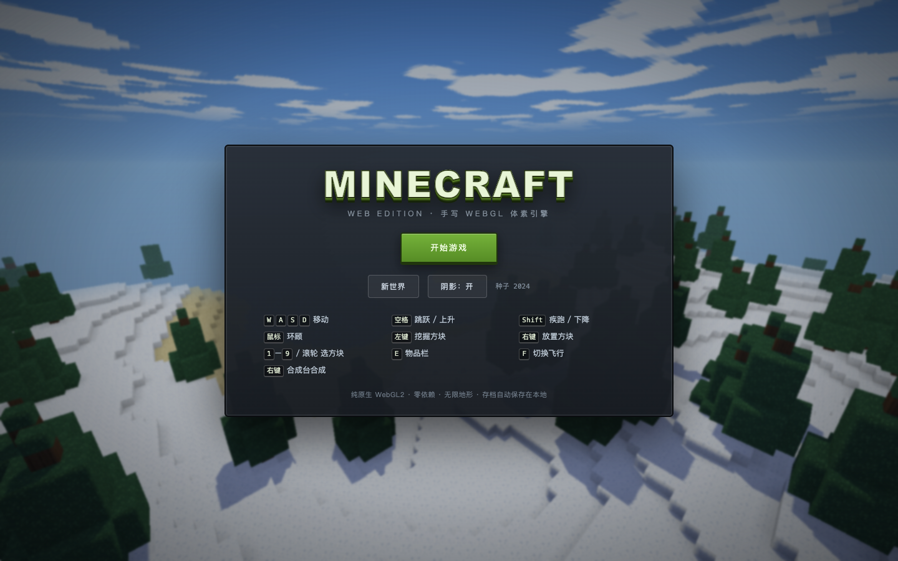

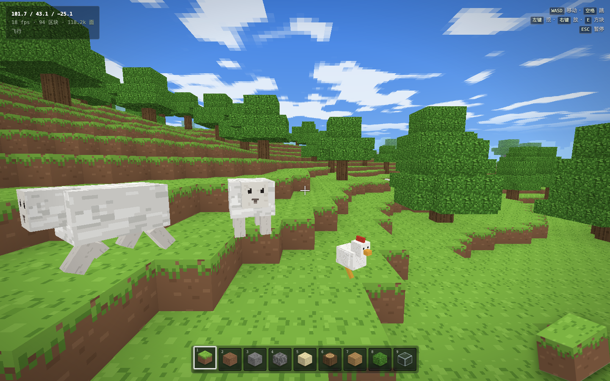

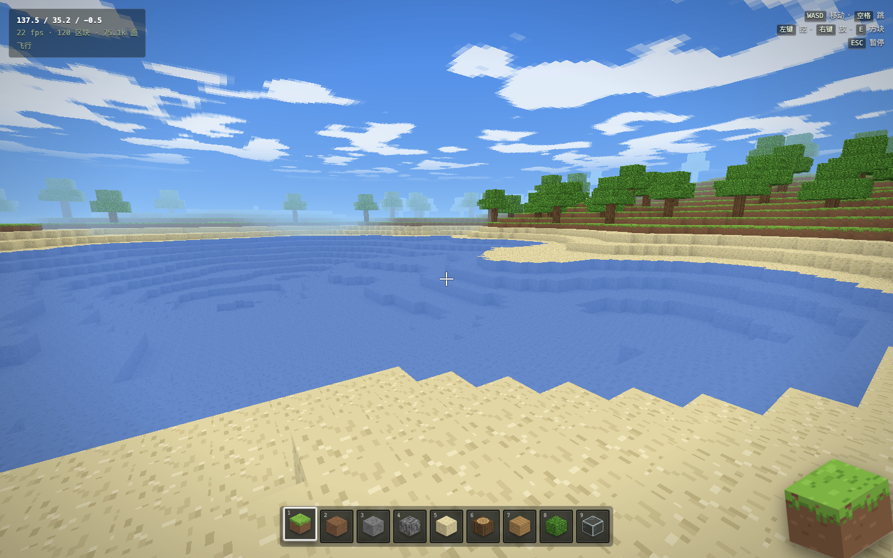

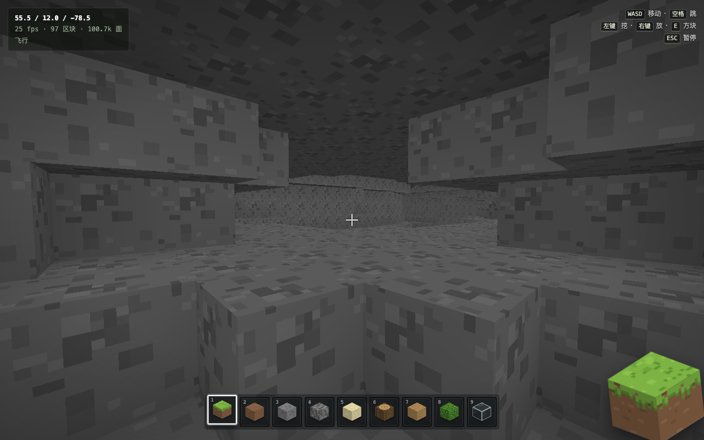

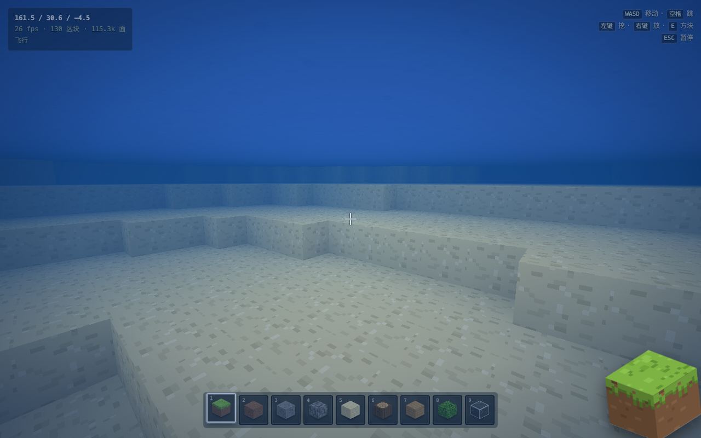

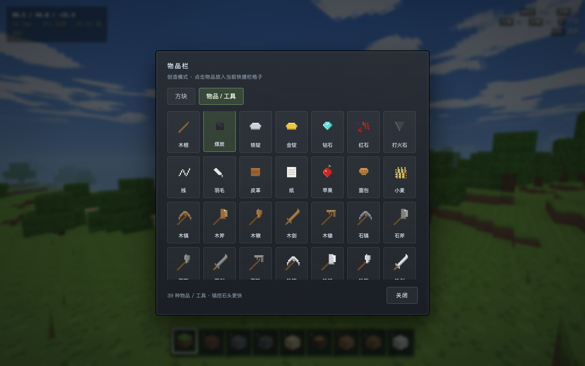

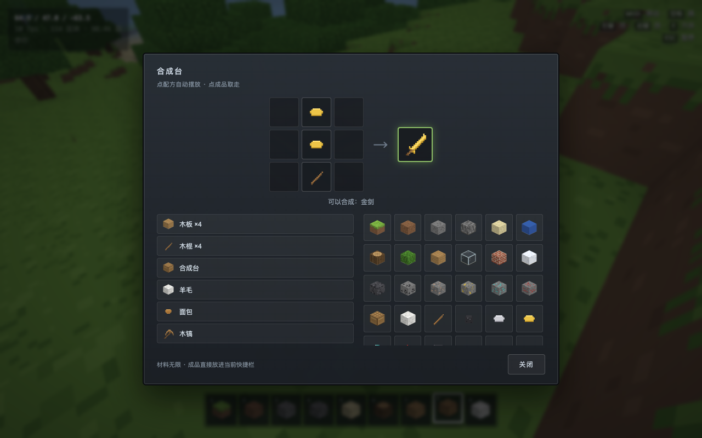

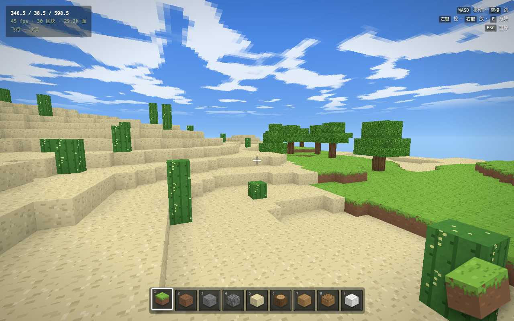

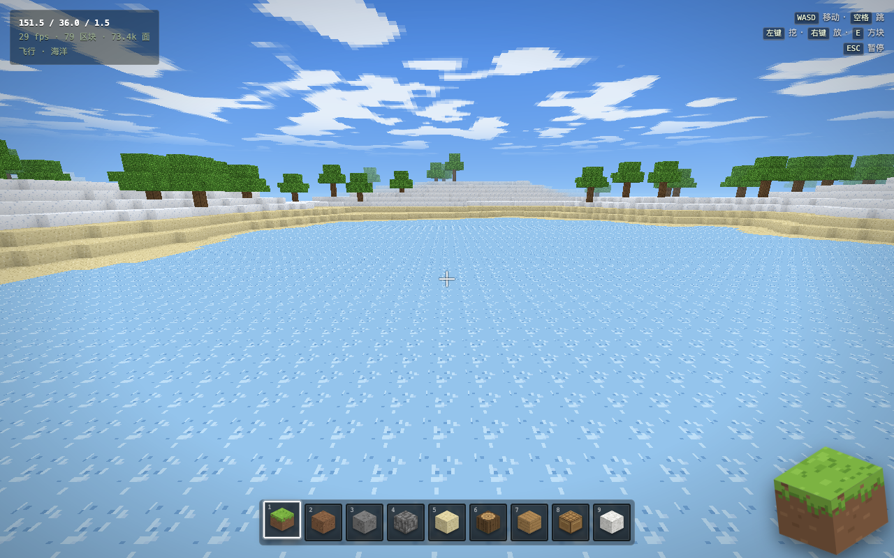

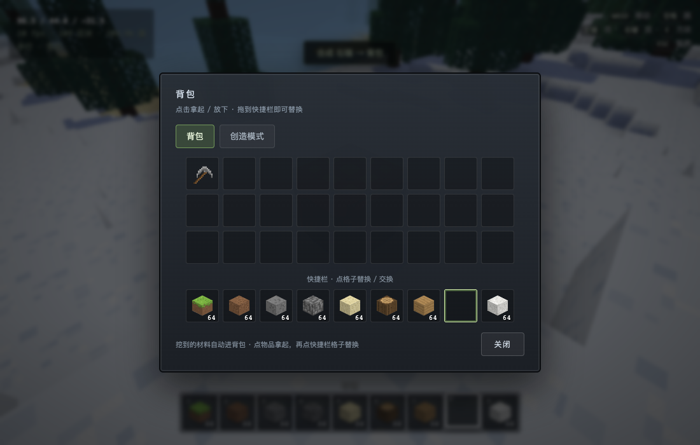

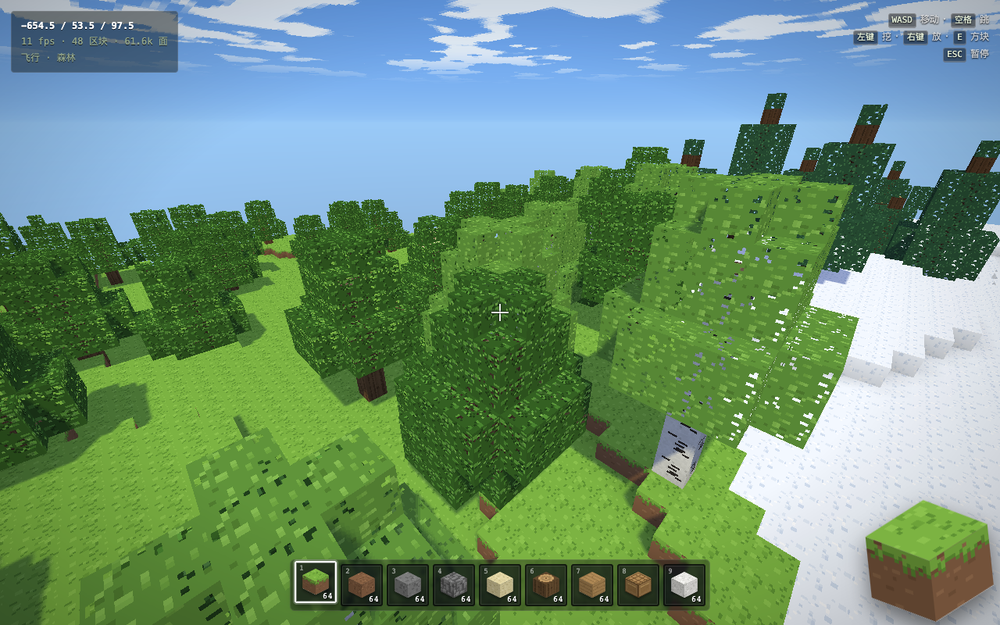

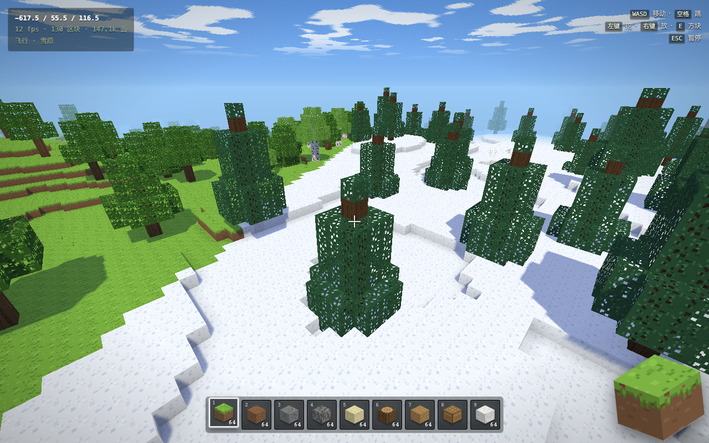

---

## 立即开始

```bash
# 方式一：直接双击
open index.html

# 方式二：本地静态服务器（可选）
python3 -m http.server 8000
# 浏览器打开 http://localhost:8000
```

> 需要支持 **WebGL2** 的现代浏览器（Chrome / Edge / Safari 15+ / Firefox）。
> 进度条走完点「开始游戏」，鼠标会被锁定，按 `ESC` 暂停。

## 操作

| 按键 | 功能 |
| --- | --- |
| `W` `A` `S` `D` | 移动 |
| `空格` | 跳跃 / 游泳 / 飞行上升 |
| `Shift` | 疾跑（飞行时下降） |
| `Ctrl` | 飞行时加速 |
| 鼠标移动 | 环顾四周 |
| 左键（可长按） | 挖掘方块 / 攻击生物 |
| 右键（可长按） | 放置方块 |
| `1` – `9` / 滚轮 | 切换快捷栏 |
| `E` | 背包（背包 / 创造模式两个页签） |
| 右键合成台 | 打开 3×3 合成界面 |
| `F` / 双击空格 | 切换飞行 |
| `M` | 显示 / 隐藏左上角地形地图 |
| `T` | 切换正午 / 日落 / 午夜 / 日出 |
| `ESC` | 暂停 / 释放鼠标 |

## 已经实现的内容

- **一个连续世界中的全部已实现地形**：每组 3×3 大区域包含平原、森林、针叶林、雪原、山地、樱花林、沙漠、恶地和海洋；海岸、河流与群系边界平滑衔接，不需要切换世界。种子决定具体地形起伏与装饰
- **更丰富的风景**：山脊与岩石露头、蜿蜒河道、恶地台地、森林苔藓斑块、更多樱花花瓣与山地/针叶林漂砾
- **两座高雪山**：初始山地区域附近生成两座随种子轻微偏移的高峰，约在 `(210, 210)` 与 `(326, 318)`；山体高度平滑融入邻近丘陵，岩石山腰与带有起伏雪线的雪顶相接
- **环山登顶**：两座雪山各有三格宽的盘山步道，跨区块连续铺设并清出通行空间；小地图以金线显示路线与入口。山腰的云雾有疏密、高低和形状变化，雪坡穿插露岩与冰面；山顶有冰台彩蛋，首次登顶可领取钻石奖励，领取状态会保存
- **地形小地图**：左上角显示周围约 1300 格的地形、玩家朝向和 1/2 号雪山标记，并给出最近雪山的方向与距离；按 `M` 可隐藏。地图逐帧绘制，不会要求远处世界区块立即加载
- **新增樱花林与恶地**：樱花树、可采集的粉红花瓣、樱花木板；恶地有红沙、分层彩色陶瓦与台地地形。原有的平原 / 森林 / 沙漠 / 雪原 / 山地 / 沙滩 / 海洋（含冻洋）仍保留
- **地下群系**：繁茂洞穴的苔藓与黏土、滴水石洞穴的滴水石块与体素化钟乳石/石笋；进入地下时 HUD 会显示洞穴群系
- **视距 7 区块**（约 112 格），更远的山和海能一起入镜
- **地下洞穴**：3D 噪声等值面挖出的蜿蜒隧道与溶洞
- **生物**：羊、鸡、牛、猪和兔子按地形出现，会随机漫步、撞墙起跳、掉进水里会浮起来；有碰撞体、血量、受击闪红和击退，击败后获得羊毛、羽毛、生牛肉、生猪肉或皮革；最多同时 14 只，走远自动回收
- **物品体系**：80 件物品 —— 39 种方块（含火把）、16 种材料/食物、25 把工具（木/石/铁/金/钻石 × 镐/斧/锹/剑/锄），全部有 16×16 程序化图标
- **合成台**：摆放后右键打开 3×3 合成界面，36 条配方；左侧配方一键预览，点成品时检查并扣除背包材料，产物进入背包。煤炭 + 木棍可合成 4 根火把
- **挖掘与工具**：按方块硬度 + 工具类型计算挖掘时间，十字准星下有进度条；工具有耐久，挖掘与剑攻击消耗 1 点，归零损坏
- **放置消耗**：放方块会消耗快捷栏里的数量，用完变空；材料可以从背包挪过来或去创造页补
- **透光树叶**：树叶贴图带镂空 alpha，能透过树冠看到天空和树干，树影下也不会完全闷死
- **水下视角**：进到水面以下会切到蓝雾 + 短视距，屏幕加一层水色，水面从下往上也可见，音效同时变闷；浮出水面自动恢复
- **四种树**：橡树 / 白桦 / 云杉 / 樱花树，按群系分布（森林混白桦、雪原只长云杉、樱花林生长樱花树），
  圆冠带随机砍角、云杉是分层圆锥冠；树叶和树皮全部重画（叶簇 + 深色缝隙）
- **动态光影**：20 分钟昼夜循环，太阳/月亮与地面光照、阴影方向同步；2048² 阴影贴图 + 3×3 PCF，
  叶片镂空也会投出对应阴影；阴影投影吸附纹素以减少镜头移动时的抖动，暂停页可关闭阴影
- **区块流式加载**：视距 7 区块，按距离优先级生成/网格化/卸载，边玩边加载
- **网格优化**：面剔除 + 环境光遮蔽（AO）+ 天空深度衰减，十万级面也能跑满帧
- **火把光照**：14 级方块光只在放置、挖掉或新区块加载时传播；夜晚和洞穴中可照亮周围，石墙会阻挡光传播
- **粒子**：挖掘碎屑、脚步扬尘、水花与生物受击粒子共用 512 个槽位和一次 WebGL 绘制；暂停页可关闭
- **完整生存物理**：AABB 分轴碰撞、跳跃、游泳浮力、飞行，65° 垂直视野与轻微疾跑视野变化
- **交互**：体素射线拾取、方块高亮线框、挖掘/放置、长按连续操作
- **画面**：程序化像素纹理图集、昼夜渐变天空、日落、月亮、星空、方块状薄云、匹配天空的距离雾
- **第一人称手臂**：空手时显示带像素皮肤和衣袖的 3D 手臂；持物时隐藏手臂，显示右下角物品图标，两者都支持行走摆动和挥动
- **矿石**：煤/铁/金/钻石/红石按深度生成在石层里，各带专属矿石贴图
- **水下挖掘**：挖掉的方块会被水灌满，不会留下奇怪的空气泡（和原版一样）
- **音效**：WebAudio 实时合成，按材质分 13 套音色（草/土/石/木/沙/玻璃/水……）的挖掘、放置、脚步；羊叫、鸡叫、入水/出水水花；水下自动低通闷音 + 循环水声底噪 + 随机气泡
- **存档**：修改、背包、快捷栏自动写入 `localStorage`，刷新后世界、建造和物品都还在
- **界面**：启动页 / 暂停页 / 方块栏 / 快捷栏 / 坐标 FPS 面板 / 等距方块图标
- **玻璃界面**：启动/暂停、背包、合成台、HUD 和快捷栏统一采用半透明毛玻璃样式；操作区按移动探索与建造界面分组，小屏可滚动查看

## 技术细节

```
minecraft/
├── index.html        页面外壳、HUD、启动/暂停/方块栏 UI 与全部样式
├── screenshots/      截图（启动页 / 游戏画面 / 洞穴）
└── js/
    ├── noise.js      mulberry32 随机数 + 2D/3D 值噪声 + fBm
    ├── blocks.js     16×16 像素纹理 → 256×256 图集；方块/生物贴图；等距图标绘制
    ├── world.js      Uint8Array 区块、地形/洞穴/树生成、编辑索引、出生点评分
    ├── minimap.js    逐帧绘制地形概览、玩家方向与雪山标记
    ├── mesher.js     面剔除 + AO 顶点烘焙 + 天空深度，输出交错的顶点/索引缓冲
    ├── renderer.js   原生 WebGL2：着色器、视锥剔除、透明批次、天空/云、线框
    ├── particles.js  512 粒子池、运动与一次点精灵绘制
    ├── viewmodel.js  空手时的第一人称手臂与动画
    ├── player.js     AABB 碰撞、水中/飞行、DDA 体素射线
    ├── items.js      物品注册表、材料与 25 把工具的程序化图标
    ├── crafting.js   36 条配方 + 3×3 形状匹配
    ├── mobs.js       羊/鸡/牛/猪/兔子的盒子模型、走跳动画、随机漫步 AI、生成与回收
    └── main.js       启动流程、输入、区块调度、挖掘放置、存档、音效、HUD
```

几个关键设计：

- **区块数据**用 `Uint8Array(16×16×144)`，一个方块 1 字节；渲染时每个区块合并成一个
  `VAO + 交织顶点缓冲`（位置 3 + UV 2 + AO/面向亮度 1 + 法线 3 + 方块光 1），只在方块或光照变化时重建。
- **AO** 在每个面的四个角采样 8 个邻居，直接乘进顶点光照，配合顶/侧/底三种面向亮度，
  不增加任何运行时开销。
- **光照模型**：网格顶点烘焙 AO、地下衰减和火把光；片元着色器实时计算太阳/月亮方向和阴影。
- **纹理**全部由 `ImageData` 逐像素画出来（16×16 一盘，16×16 图集），图集留半像素内缩，
  NEAREST 采样保持像素风；水做了低对比度处理，避免大面积水面出现摩尔纹。
- **群系**：每 3×3 个区域覆盖全部已实现的地表景观，并用低频噪声扭曲边界、平滑混合地形高度；交界处的沙、雪和红沙会以斑块渐变；雪原临海会形成冻洋。
- **水面双面渲染**：透明批次临时关闭背面剔除，所以水下抬头也能看到水面；
  摄像机在水里时跳过天空、换成 `[0.07,0.29,0.55]` 蓝雾并把视距压到 20 格。
- **音效**是一个小合成器：噪声 → 带通/低通 → 包络 → 压缩器 → 主输出；方块材质决定
  中心频率和低音敲击，羊叫是带颤音的锯齿波，鸡叫是两段带通噪声。`SND` 表在 `main.js` 里可直接调。
- **天空**用全屏四边形 + 逆 VP 矩阵还原视线方向；太阳/月亮、星空、云和地面阴影共用同一时钟。
  云层按世界坐标网格生成水平延展的方块轮廓，底面和侧面分别着色，远处逐渐融入地平线。
- **存档**记录玩家改动过的方块（`Map<坐标, id>`）、物品栏和世界时间；地形本身由种子重建，
  所以存档不会随探索范围变大。

## 调参

- 换个世界：启动页「新世界」，或在地址栏加 `?seed=12345`（也支持文字种子）
- 探索地形：从出生点向各个方向走，约数百格内可找到所有已实现的地表群系；按 `F` 可飞行赶路。旧版坐标示例已不适用于新地形生成器
- 旧存档中的方块改动会保留，但周围自然地形会按新版重新生成；首次升级到当前地形时会自动备份旧存档到 `localStorage` 的 `mcweb.save.v1.before-terrain-v3`
- 想飞：进游戏按 `F`
- 调试模式：`?auto=1` 会跳过菜单直接进入（方便截图/自动化）
- 视距在 `js/main.js` 的 `RENDER_R`；世界高度/海平面在 `js/world.js` 顶部

## 关于「包含所有物品」

原版 Minecraft 有 1400+ 件物品（含所有版本、变种、刷怪蛋、药水……），一个浏览器 demo
不可能全做，这里覆盖的是**能玩起来的核心集合**：全部可放置方块 + 五种矿石 + 常用材料/食物 +
完整的两套工具树（25 把）。物品表是数据驱动的，`js/items.js` 里加一条 `def({...})` 就能扩展。

背包会收进挖掘所得，放置会消耗快捷栏物品。创造页可以无限领取物品。合成台左侧配方只负责
预览摆放，点成品时从背包扣除材料；材料不足会显示缺少的物品与数量。

## 关于「用原版材质」

Minecraft 官方的贴图和音效是 Mojang 的版权资产，不能打包进这个项目里分发，所以这里
是按原版 **16×16 像素风**手绘了一套（配色、草皮边缘、石头噪点、年轮、砖缝都对着原版感觉调的）。
如果你自己有一份正版资源，想把材质换进去也很容易：`js/blocks.js` 里每个 `tile(name, painter)`
就是把一张 16×16 的图画进图集的对应格子，把 painter 换成 `ctx.drawImage(你自己的图)` 即可。

## 已知取舍

- 没有火把等方块光源传播，夜间主要由环境光和月光照明
- 水不做流动模拟，是静态水体（但水下有蓝雾和闷音）
- 动物可以攻击并掉落物品，目前还不能繁殖
- 滴水石与花瓣使用适配本项目的体素化表现；暂未实现原版滴水石坠落伤害和花瓣叠放机制
- 只有单机，没有联机
- 手持方块用 2D 等距图标模拟（保证在任何驱动上都稳定）

---

用代码从零搭一个世界，比玩它更有意思。⛏
